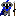
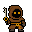

# Run Inmate, Run!

**By [@Dulla-han](https://github.com/Dulla-han)**

Run Inmate, Run! is a 2D prison escape game. You play as a captured wizard trying to escape a dark prison, avoiding dangerous enemies, collecting useful items and solving challenges along the way.


## Getting started

### Requirements

- Java Development Kit (JDK) 21
- An internet connection on the first build to download Maven dependencies

The project uses JavaFX for the game interface and JavaCV with bundled FFmpeg for the background video. A separate FFmpeg installation is not required on supported desktop platforms.

### Run the game

From the repository root on Linux or macOS:

```bash
bash mvnw javafx:run
```

On Windows:

```bat
mvnw.cmd javafx:run
```

Alternatively, open `pom.xml` as a Maven project in IntelliJ IDEA, select JDK 21 and run `game.GameStart`.

## Main mechanics

### Movement

Move in four directions or diagonally using **W**, **A**, **S** and **D**. You can run and hide, but you cannot fight back. Some enemies are faster than you, so plan your movements carefully.

### Time


You have 15 minutes to escape. Getting caught costs 60 seconds, and running out of time ends the game. The clock displays your remaining time above room exits.

### Lamp (E)


The prison is dark. Use your lamp to illuminate the environment, but remember that it also affects the distance from which patrols can spot you.

### Ability (R)


Your magical cloak makes you invulnerable and undetectable while active. You cannot move until you deactivate it. After use, the cloak has a five-second cooldown, displayed in the bottom-right corner.

### Inventory (I)

Open the inventory to view your collected items and coins in the top-left corner of the screen.

### Interaction (Space)

Interact with characters, collect items and leave rooms using **Space**.

## Entities

| Entity | Description |
| --- | --- |
|  **Wizard** | The main protagonist and owner of the magical cloak. Guide him to freedom. |
|  **Fireball** | A fast, dangerous entity that roams the prison. Avoid it using your cloak. |
|  **Patrol** | Guards patrol rooms and stop briefly before resuming their search. Their red detection range changes depending on whether the lamp is active. |
|  **Prisoner** | A neutral character who can offer advice and give you a letter. |
|  **Keymaster** | A powerful but neutral character who loves riddles. He may give you a key. |
|  **Warden** | The final challenge. Your dialogue determines whether you escape. The clock stops during this conversation. |

## Other items

| Item | Purpose |
| --- | --- |
|  **Key** | Opens locked doors, providing access to bonus rooms or shortcuts. |
|  **Letter** | Obtained from the prisoner; provides an additional dialogue option when speaking to the Warden. |
|  **Coins** | Collect coins to increase your score. Stacks can contain between one and ten coins. |

## Controls

| Action | Key |
| --- | --- |
| Move up | W |
| Move down | S |
| Move left | A |
| Move right | D |
| Open inventory | I |
| Toggle lamp | E |
| Toggle ability | R |
| Interact | Space |
| Pause | Esc |
| Toggle fullscreen | F11 |
| Select dialogue option | 1–4 |
